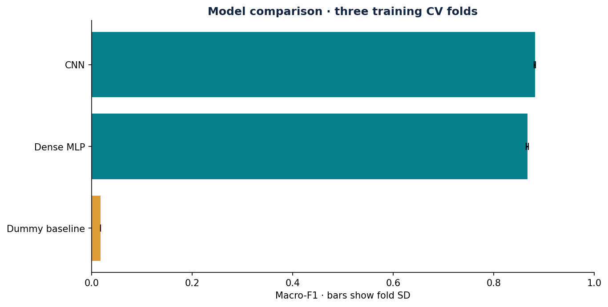
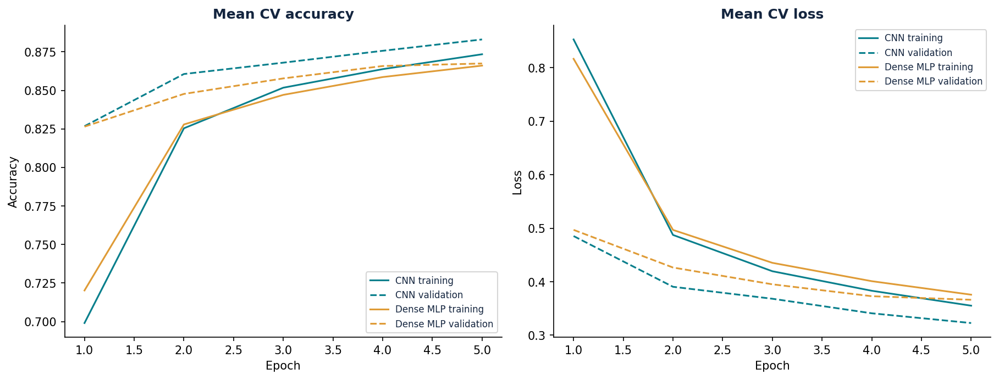
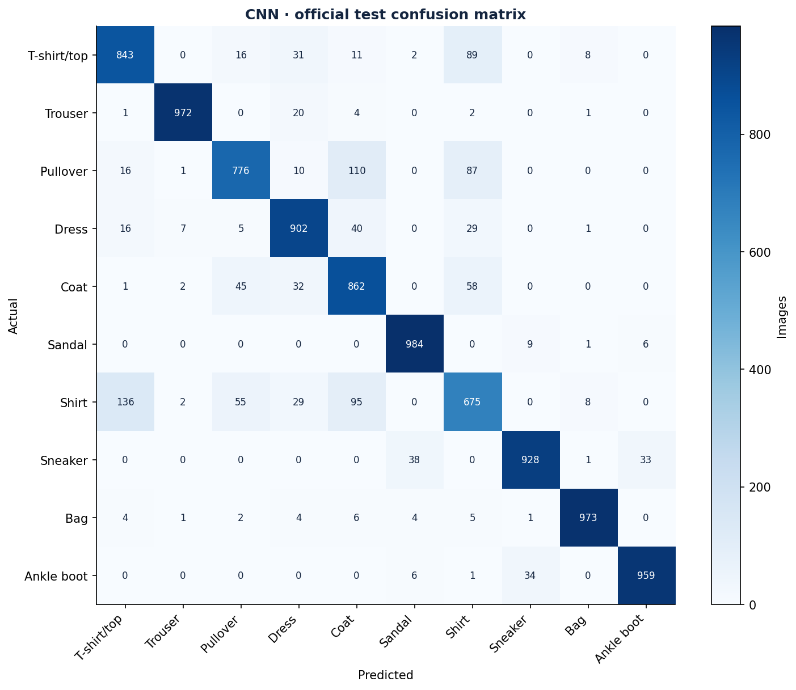
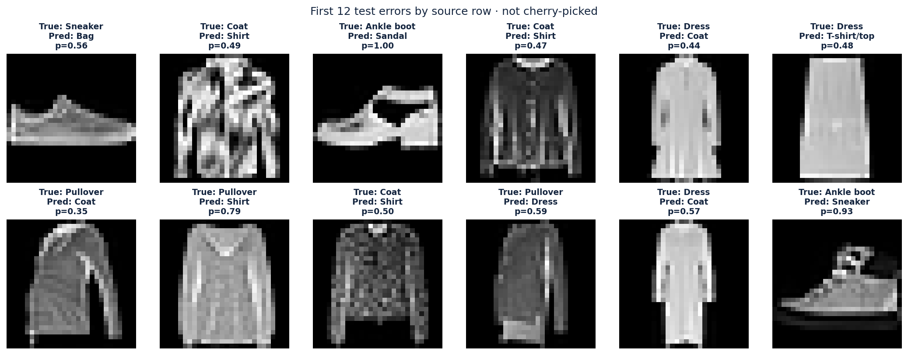
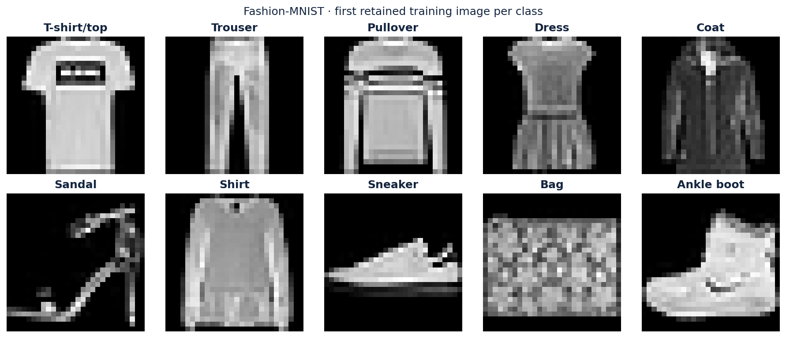
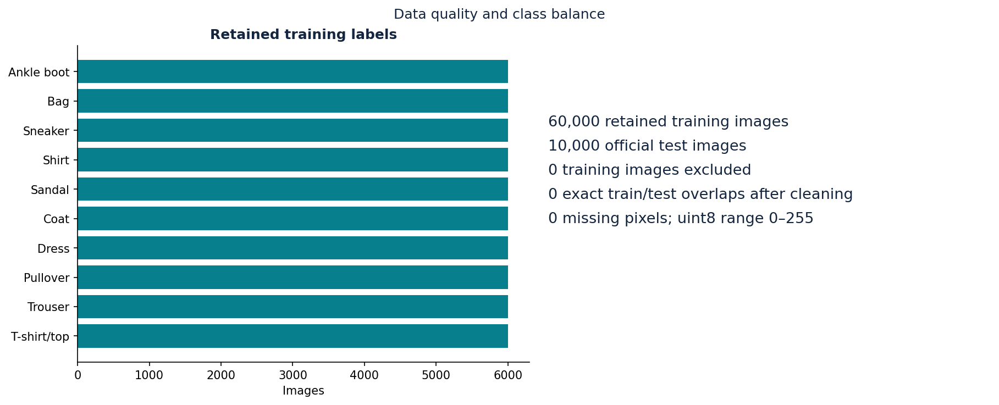

# Fashion-MNIST Classification with TensorFlow

Compare convolutional and dense neural networks for recognizing ten clothing categories from grayscale product images.

---

## Overview

* **Task:** Multi-class image classification (10 classes).
* **Dataset:** 70,000 samples, 784 pixel features per image (28 × 28 × 1); 60,000 training and 10,000 official test images.
* **Selected Model:** **TensorFlow CNN** (holdout Macro-F1 = **0.8871**).
* **Baseline Comparison:** Dummy baseline achieved holdout Macro-F1 = 0.0182.

**Question:** Do convolutional layers improve clothing recognition over a dense network under the same five-epoch training budget?

Executed on 2026-09-20 with Python 3.12.14 and TensorFlow 2.20.0. Automated study; [human review](LEARNING_NOTES.md) pending.

---

## Key Results

### Training Cross-Validation

| Model | Macro-F1 | Fold SD |
| :--- | :--- | :--- |
| **CNN** | **0.8822** | 0.0013 |
| Dense MLP | 0.8670 | 0.0021 |
| Dummy baseline | 0.0182 | 0.0000 |

Three stratified folds use the training partition only: 40,000 fitting and 20,000 validation images per fold. Seed 42, five fixed epochs, batch size 256, Adam (learning rate 0.001), and dropout 0.25 were fixed before evaluation. Pixels are rescaled to [0, 1] inside both models. No data augmentation, epoch search, or test-based selection was used. Fold SD uses `ddof=0`; it is not a confidence interval.

The CNN contains two 3 × 3 convolution layers (16 and 32 filters), max pooling after each, and a 64-unit dense layer: **105,866 trainable parameters**. The dense comparator uses 128- and 64-unit layers: 109,386 parameters. Both use ReLU hidden activations and a 10-way softmax output. Equal epoch counts do not imply equal computation time. The dummy predicts the most frequent training label; ties select class 0.

### Final Holdout Evaluation (10,000 Samples)

| Model | Macro-F1 | Accuracy | Balanced Accuracy |
| :--- | :--- | :--- | :--- |
| **CNN** | **0.8871** | **0.8874** | **0.8874** |
| Dummy Baseline | 0.0182 | 0.1000 | 0.1000 |

After selection, the CNN was refitted on all 60,000 training images for five epochs. Only the selected CNN and dummy were scored on the official test set. Accuracy and balanced accuracy coincide because each test class contains 1,000 images.

**Error analysis:** 1,126 test images were misclassified. Shirt was the weakest class (F1 = 0.6937; recall = 0.6750). The largest directed confusions were Shirt → T-shirt/top: 136; Pullover → Coat: 110; Shirt → Coat: 95. The error gallery shows the first 12 errors in source order. Softmax confidence is uncalibrated, and a high score can accompany an incorrect prediction.

Saved weights were reloaded and produced identical probabilities for all 10,000 test images. Holdout scores were independently recalculated from the saved predictions; [verification details](verification.json) record the checks. This does not establish bit-for-bit agreement across different hardware or dependency versions.

---

## Data Summary

* **Source:** [Fashion-MNIST, Zalando Research](https://github.com/zalandoresearch/fashion-mnist), by Han Xiao, Kashif Rasul, and Roland Vollgraf; MIT license. [Source attribution and checksums](SOURCE.md).
* **Data Quality:** 70,000 usable images, 784 pixel features, 0 missing cells, 0 duplicates removed, and 0 exact training/test pixel overlaps. All four source files passed published checksum, decompressed-length, header, shape, and value checks.
* **Key Feature:** The CNN learns spatial filters from the image grid. Individual-pixel permutation importance was not computed, so no ranked or causal feature claim is made.
* **Collinearity / Notes:** Pixels retain their spatial arrangement in the CNN; the dense comparator flattens them. Product identities and near-duplicate relationships are unavailable. These controlled 28 × 28 images do not establish performance on real-world photographs. The five-epoch study compares two fixed architectures and does not claim a fully optimized benchmark.

Validation accuracy exceeds training accuracy in these learning curves. Training metrics are accumulated while weights change and dropout is active; validation uses the epoch-end model with dropout disabled. This difference alone is not evidence of leakage.

---

## Visualizations

| Model Comparison | Learning Curves |
| :---: | :---: |
|  |  |

| Confusion Matrix | Error Examples |
| :---: | :---: |
|  |  |

| Dataset Examples | Data Quality |
| :---: | :---: |
|  |  |

The [image intensity distribution and mean image](figures/distributions.png) provide additional training-data context.

---

## Repository Structure

```text
├── figures/                   # Seven dataset, learning, performance, and error plots
├── analysis.ipynb             # Executed walkthrough of the recorded analysis
├── train.py                   # TensorFlow training, source validation, and chart pipeline
├── verify.py                  # Source, split, score, and saved-weight verification
├── study_config.json          # Fixed model settings and source checksums
├── requirements.txt           # Pinned core dependencies
├── environment.lock.txt       # Complete training environment package versions
├── notebook-requirements.txt  # Additional notebook dependencies
├── audit.json                 # Full dataset quality and overlap audit
├── execution.json             # Runtime versions, settings, and execution hashes
├── data_sources.json          # Pinned source URLs and complete-file hashes
├── data_dictionary.csv        # Pixel and label types and bounds
├── descriptive_statistics.csv # Training pixel summary statistics
├── class_names.csv            # Class IDs and human-readable labels
├── cv_assignments.csv         # Source training row IDs and validation fold IDs
├── excluded_training_rows.csv # Exclusion audit (no exclusions in this study)
├── splits.json                # Official holdout and cross-validation protocol
├── selection.json             # Model choice frozen before test scoring
├── training_history.csv       # Actual per-epoch training and validation logs
├── metrics.json               # Full cross-validation, holdout, and per-class scores
├── predictions.csv            # Predictions for all 10,000 official test images
├── error_analysis.csv         # All 1,126 incorrect test predictions
├── test_probabilities.npy     # Numeric class probabilities; no pickle objects
├── model_architecture.json    # Selected TensorFlow model architecture
├── model.weights.h5           # Fitted weights and optimizer state
├── model_summary.txt          # Layer shapes and parameter counts
├── verification.json          # Independent checks and numeric weight-file inventory
├── project.json               # Completion manifest and artifact hashes
├── repository_metadata.json   # Suggested standalone name, About text, and topics
├── SOURCE.md                  # Dataset attribution, provenance, and licensing
├── DATA_LICENSE.txt           # Original dataset MIT license
├── LEARNING_NOTES.md          # Unanswered prompts for the human author
├── report.html                # Report with relative links to the graph files
└── README.md
```
